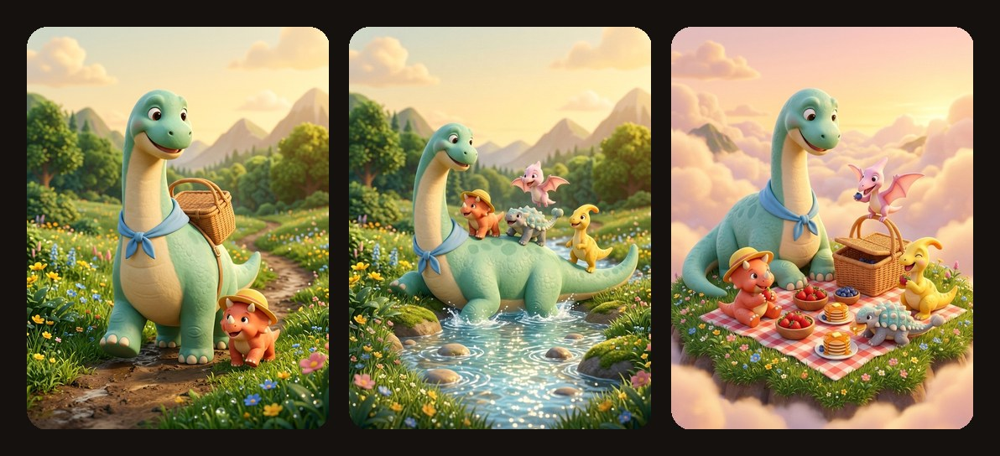
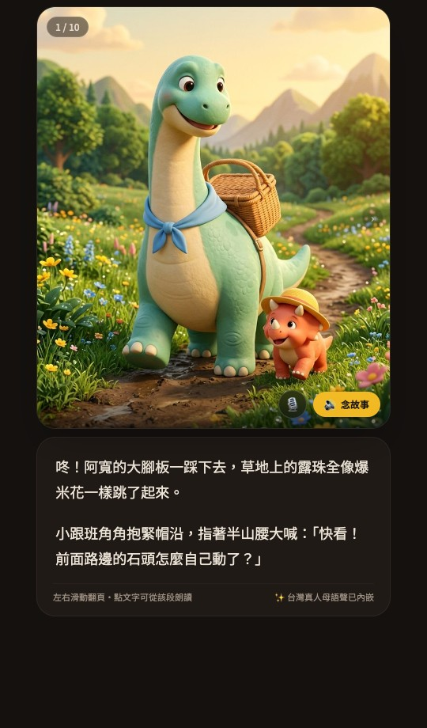

# 📖 Ann Storybook (`ann-storybook`)

**AI 兒童互動有聲繪本生成技能（Agent Skill）**

只需輸入故事靈感、角色想法或喜歡的主題，即可自動規劃分鏡、生成具備高度角色一致性的 **3:4 手機直式插圖**，並封裝成 **100% 獨立運作的單一 HTML5 有聲繪本 Web App**。

支援**自由指定或依故事自動匹配繪本畫風**（透明水彩、粉彩蠟筆、剪紙拼貼、厚塗不透明水彩、溫暖黏土/3D 等）、台灣國語（`zh-TW`）自然語音朗讀、句段同步高亮、單手滑動翻頁，以及爸媽親自錄音功能。



---

## ✨ 行動端閱讀介面預覽

專為睡前共讀打造的夜間低藍光護眼介面（深可可暖黑背景 `#14110F` 搭配羊皮紙柔光文字 `#EDE4D7`）：

<p align="center">
  
</p>

---

## 🎨 核心設計理念：質感與創作彈性兼具

1. **自由指定或智慧匹配畫風**：
   - **自訂風格**：你可以直接描述想要的畫風（例如：「溫暖透明水彩」、「蠟筆童趣手繪」、「剪紙拼貼風」或「立體黏土動畫風」）。
   - **自動匹配**：若未特別指定畫風，技能會自動根據故事的情緒與題材，挑選最相襯的繪本媒材，並透過 `Style Anchor` 與 `Character Visual Sheet` 維持全書跨頁一致。

2. **自然延伸故事脈絡**：
   - 無論是輸入完整故事設定，或是只有一句簡單的靈感，都會順著你的創意自然發展情節，不套用僵化的單一模板。

3. **講究繪本圖文互補與朗讀呼吸感**：
   - **圖文互補**：畫面已經畫出的顏色與外觀不在文字中重複贅述，文字專注呈現聲音、溫度、細微動作與角色心情。
   - **具象生動**：以具體的肢體動作與貼近孩子日常的感受取代空洞的罐頭疊字。
   - **翻頁動勢與換氣節奏**：跨頁間自然留有好奇心與翻頁動勢，短句長度適中，讓家長與語音朗讀時流暢自然。

---

## 🌟 執行環境與語音體驗說明

本技能遵循開放的 `SKILL.md` 標準，可在 **Google Gemini 網頁版（Gemini 任務 / Gemini Chat）** 以及 **本機端 AI Agent（Antigravity / Claude Code / Gemini CLI）** 執行。

### 1. Google Gemini 網頁版（Gemini 任務 / 前身為 Gemini Spark）— 🏆 原生雲端體驗

在 Gemini 網頁版匯入此技能後，於 **Gemini 任務（Tasks）** 或對話中呼叫：

- **直接串接 Gemini 語音模型**：網頁版 Canvas 容器會自動帶入雲端授權，直接呼叫 **Gemini 2.5 Flash TTS (`gemini-2.5-flash-preview-tts`)**。
- **免填 API Key**：無須額外設定金鑰，即可合成溫柔自然的「台灣故事媽媽」語音，並內建防限流保護與自動重試機制。
- **即時互動與下載**：生成後可直接在右側 Canvas 翻頁共讀，或下載 `.html` 與 `.wav` 語音檔。

---

### 2. 本機端 AI Agent（Antigravity / Claude Code / Gemini CLI）— 💻 離線單檔封裝

在本機端執行並用瀏覽器直接打開 `.html` 檔時，可透過以下 3 種方式使用自然語音：

1. **由本機 Agent 預先合成語音嵌入 HTML（最推薦）**  
   請本機 Agent 透過 `edge-tts`（`zh-TW-HsiaoChenNeural` 台灣自然女聲）或 Gemini API 預先合成 10 頁語音，轉為 Base64 寫入 `PAGES[i].audio`。產出的單一 HTML 檔案**免填 Key、免聯網、點開即播真人語音**，方便傳至手機或 LINE 分享。
2. **在繪本播放器內填入 Gemini API Key**  
   點擊繪本右下角 `🎙️` 按鈕 → 展開「進階選項」→ 貼入 Gemini API Key，即可在瀏覽器即時呼叫 Gemini TTS。
3. **爸媽親自錄音或匯入音檔**  
   點擊右下角 `🎙️` 按鈕，直接使用手機或電腦麥克風為孩子錄下專屬的睡前朗讀。

---

## 📦 安裝方式

### 方式一：在 Google Gemini 網頁版（技能 / Gemini 任務）匯入

1. 下載本儲存庫的 [`SKILL.md`](SKILL.md) 與 [`assets/storybook_template.html`](assets/storybook_template.html)（或直接打包為不含隱藏檔的 `.zip`）。
2. 在 Gemini 網頁版進入「**技能（Skills）**」上傳匯入。
3. 在 **Gemini 任務（Tasks）** 或對話中輸入你的故事想法即可開始製作。

---

### 方式二：在 Antigravity / Claude Code / Gemini CLI 安裝

將本儲存庫 Clone 至本機 Skills 目錄即可載入：

```bash
# Antigravity / Gemini CLI
git clone https://github.com/bboyfan/ann-storybook.git ~/.gemini/config/skills/ann-storybook

# Claude Code
git clone https://github.com/bboyfan/ann-storybook.git ~/.claude/skills/ann-storybook
```

---

## 💡 提示詞範例

### 範例 1：只給故事靈感（讓技能自動匹配最適合的畫風與節奏）

```text
請幫我做一本睡前有聲繪本：
小雲朵不想這麼早睡覺，偷偷溜下山谷找地方躲貓貓，結果把森林裡動物們的尾巴都染成棉花糖色了。
```

---

### 範例 2：指定喜歡的繪本畫風與角色細節

```text
請製作一本 10 頁的兒童有聲繪本：
- 故事：愛生氣的大棕熊撿到一顆會滾動的小松果，裡面鑽出一隻完全不怕他、還把他大肚子當彈跳床的小睡鼠。
- 畫風：請用溫暖的透明水彩搭配柔和手繪鉛筆線條，色調溫暖柔和。
```

---

### 範例 3：冷面幽默與圖文反差風格

```text
請製作一本互動有聲繪本：
- 故事：小橘貓阿布打翻了桌上的牛奶杯，但他一本正經地向剛走進廚房的媽媽推理「為什麼這絕對是外星章魚幹的好事」。
- 畫風：極簡剪紙拼貼與不透明水彩（Gouache）風格，文字要一本正經，但畫面要悄悄露出阿布鬍鬚上沾滿牛奶的破綻。
```

---

## 📁 專案結構

```text
ann-storybook/
├── README.md                        # 技能說明書與使用指南
├── SKILL.md                         # 繪本生成核心流程（彈性故事企劃＋自訂/自動畫風匹配＋一致性錨點）
└── assets/
    ├── storybook_template.html      # 行動端直式 3:4 有聲繪本播放器模板
    ├── preview_player.jpg           # 行動端閱讀器畫面截圖
    └── preview_showcase.jpg         # 跨頁角色一致性插圖展示
```

---

## 📄 License

MIT License
